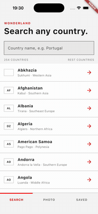
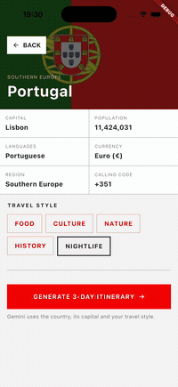
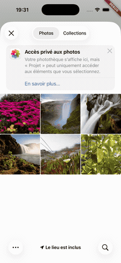
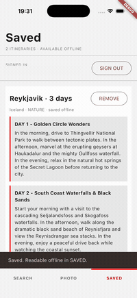

<div align="center">

# WonderLand

**Cherche un pays, laisse Gemini écrire ton itinéraire de 3 jours, garde-le lisible hors-ligne.**
**Prends la photo d'un monument : Gemini Vision devine le lieu et le pays.**

[](https://flutter.dev)
[](https://dart.dev)
[](https://riverpod.dev)
[](https://pub.dev/packages/go_router)
[](https://firebase.google.com)
[-6E56CF)](https://pub.dev/packages/isar_community)
[](https://firebase.google.com/docs/ai-logic)

Projet fil rouge M2 IWID - IIM &middot; Android &amp; iOS

</div>

---

## Démo

| Recherche d'un pays | Itinéraire par Gemini | Gemini Vision | Favoris hors-ligne |
|:---:|:---:|:---:|:---:|
|  |  |  |  |
| REST Countries, filtre instantané | 3 journées écrites par Gemini | La photo est identifiée, lien vers le pays | Lus dans Isar, visibles sans réseau |

Démo complète (1 min 37, enregistrée sur iPhone 17) :
[apple-recording.mp4](docs/Video-App/apple-recording.mp4).

## Fonctionnalités

| Écran | Ce qu'il fait |
|---|---|
| Sign in | Email / mot de passe, Google, Apple(non fonctionnelle car pas d'abonnement à 100$/ans), ou invité (Firebase Auth) |
| Search | Liste des pays via l'API publique REST Countries, filtre par nom ou capitale |
| Country | Fiche du pays (capitale, population, langues, monnaie...) + choix du style de voyage |
| Itinerary | Gemini génère 3 journées, bouton "SAVE TO FAVORITES" |
| Photo | Caméra ou galerie, Gemini Vision devine le lieu et le pays, lien vers la fiche |
| Saved | Favoris lus dans Isar (mode avion OK), synchronisés avec Cloud Firestore |

## Architecture (Riverpod 2.x + GoRouter)

```
lib/
├── main.dart                 # Firebase, App Check, ouverture Isar, ProviderScope, MaterialApp.router
├── models/                   # Objets simples : Country, Itinerary (Isar), PhotoAnalysis
├── services/                 # Clients externes, une classe par techno
│   ├── auth_service.dart         # Firebase Auth
│   ├── countries_service.dart    # HTTP REST Countries
│   ├── firestore_service.dart    # Cloud Firestore
│   ├── gemini_service.dart       # Gemini (texte + vision) via Firebase AI Logic
│   ├── local_db_service.dart     # Isar (base locale)
│   └── photo_service.dart        # image_picker (caméra / galerie)
├── repositories/             # Logique métier, combinent les services
│   ├── country_repository.dart   # charge + filtre les pays
│   ├── itinerary_repository.dart # génère, sauvegarde (Isar + Firestore), supprime
│   └── photo_repository.dart     # photo -> Gemini Vision
├── providers/                # Riverpod : l'état que les écrans observent
│   ├── auth_providers.dart       # authStateProvider (StreamProvider)
│   ├── country_providers.dart    # countriesProvider, searchQueryProvider
│   ├── itinerary_providers.dart  # itineraryProvider (family), savedItinerariesProvider
│   ├── photo_providers.dart      # photoProvider (AsyncNotifier)
│   └── ui_providers.dart         # onglet actif, style choisi, bouton SAVED (StateProvider)
├── router/
│   └── app_router.dart       # GoRouter : /login, /, /country, /itinerary + redirect auth
├── screens/                  # Les écrans (ConsumerWidget), aucun calcul métier
└── widgets/                  # AppShell (onglets), DayCard, MessageView
```

Le principe : un écran fait `ref.watch(unProvider)` et affiche le résultat
avec `state.when(loading: ..., error: ..., data: ...)`. Les calculs (filtre,
appels réseau, sauvegarde) sont dans les repositories et les services.

La navigation passe par GoRouter : les écrans font
`context.push('/country', extra: country)` et le `redirect` du routeur
renvoie vers `/login` tant que personne n'est connecté.

Exemple, `lib/screens/search_page.dart` :

```dart
final countries = ref.watch(countriesProvider);
final query = ref.watch(searchQueryProvider);
return countries.when(
  loading: () => const CircularProgressIndicator(),
  error: (error, _) => MessageView(title: 'Could not load countries.', message: '$error'),
  data: (all) => _CountryList(countries: repository.filter(all, query)),
);
```

## Persistance double

- **Isar** (`local_db_service.dart`, package `isar_community`, le fork
  maintenu d'Isar 3 avec la même API) : chaque favori est écrit en local
  d'abord. L'onglet Saved lit uniquement Isar, donc il marche en mode avion.
- **Cloud Firestore** (`firestore_service.dart`) : le même favori est envoyé
  dans `users/{uid}/itineraries/{id}`. Hors-ligne, Firestore garde l'écriture
  en attente et l'envoie au retour du réseau. Au démarrage, les favoris du
  cloud absents en local sont rapatriés (nouvel appareil).

## Démarrage rapide

### Prérequis

- Flutter 3.47 / Dart 3.13 (`flutter --version`)
- Un projet Firebase avec Auth, Firestore et **AI Logic** (Gemini Developer
  API) activés. Le fichier `lib/firebase_options.dart` est généré par
  `flutterfire configure`.
- Une clé REST Countries (gratuite) : https://restcountries.com/sign-up

### Installation

```sh
flutter pub get
cp .env.example .env         # puis renseigner REST_COUNTRIES_API_KEY
dart run build_runner build --delete-conflicting-outputs   # régénère itinerary.g.dart (Isar)
```

### Lancer

```sh
flutter devices
flutter run -d <id> --dart-define-from-file=.env
```

`--dart-define-from-file=.env` transmet la clé REST Countries à l'app.

Dans VS Code, **F5** suffit : `.vscode/launch.json` contient les trois
configurations (debug, profile, release) avec l'option déjà en place.

### App Check (une fois par simulateur / appareil)

En debug, App Check utilise un jeton de débogage. Lancer l'app, récupérer le
jeton dans les logs (`App Check debug token: ...`, sur iOS via
`xcrun simctl spawn booted log show --predicate 'eventMessage CONTAINS "App Check"'`)
et l'ajouter dans Console Firebase > App Check > Gérer les jetons de débogage.
Sans ça, Gemini répond avec une erreur de permission.

## Tests

```sh
flutter test
```

Deux tests couvrent les deux niveaux demandés. Ils ne lisent pas la clé API,
donc `--dart-define-from-file=.env` est inutile ici.

| Fichier | Type | Ce qui est vérifié |
|---|---|---|
| [test/models/country_test.dart](test/models/country_test.dart) | Test unitaire (`test` / `expect`) | `Country.fromJson` décode un pays de la réponse REST Countries (champs imbriqués `names.common`, `capitals[0].name`, `currencies`, `calling_codes`), puis les getters d'affichage `populationText` (`10305564` -> `10,305,564`) et `subtitle`, et enfin le filtre `matches('por')` de la barre de recherche |
| [test/widgets/message_view_test.dart](test/widgets/message_view_test.dart) | Test de widget (`testWidgets`) | `MessageView`, le bloc des états vide et erreur, est monté dans un `MaterialApp` : les textes sont trouvés avec `find.text`, puis `tester.tap` sur le bouton confirme que le callback `onPressed` est bien appelé |

Le modèle `Country` est du Dart pur et `MessageView` ne dépend d'aucun
provider : les deux tests tournent donc sans réseau, sans Firebase et sans
`ProviderScope`.

## Mode avion

- Search : message "Could not load countries." + bouton RETRY.
- Itinerary / Photo : message d'erreur Gemini + RETRY, pas de crash.
- Saved : les favoris Isar s'affichent normalement.
- Une sauvegarde faite hors-ligne est envoyée à Firestore à la reconnexion.

## Modèle Gemini

`GeminiService.modelName` (`gemini-3.5-flash-lite`) est utilisé pour le
texte et les images. Si Google renvoie 503 (capacité), changer ce nom ou
réessayer plus tard.

## Pitch (3 min)

1. Sign in en invité.
2. Search "por" -> Portugal -> style FOOD -> GENERATE : Gemini répond.
3. SAVE TO FAVORITES -> onglet SAVED -> couper le réseau : toujours visible.
4. Onglet PHOTO -> galerie -> photo d'un monument -> Gemini Vision -> OPEN
   <PAYS>.

## Documentation technique

Le dossier [`docs/`](docs/Documentation-technique.md) détaille le projet :

| Document | Contenu |
|---|---|
| [architecture.md](docs/architecture.md) | Couches, providers Riverpod, navigation GoRouter, gestion des erreurs |
| [data-and-persistence.md](docs/data-and-persistence.md) | Modèles, Isar, Firestore, stratégie hors-ligne |
| [services.md](docs/services.md) | REST Countries, Firebase Auth, Gemini, App Check, image_picker |
| [setup.md](docs/setup.md) | Configuration Firebase pas à pas, lancement, dépannage |
| [Image-Design/](docs/Image-Design/) | Maquettes des écrans |

## Sources et ressources

Toutes les références consultées pour écrire ce projet, regroupées par thème.

### Cours et tutoriels

| Source | Ce que j'y ai pris |
|---|---|
| Support de cours "Architecture & Développement Mobile avec Flutter" (IIM, projet fil rouge WanderLens AI) | Le découpage models / services / providers / views, Riverpod 2.x, GoRouter, Isar, le principe du projet |
| Vidéo de Graven, [Créer un bouton "Login with Google" en Flutter \| Firebase Auth](https://www.youtube.com/watch?v=DHDyrFxRdlw) | La connexion Google avec Firebase Auth, adaptée ensuite à `google_sign_in` 7.x |
| Article [Building a Simple Login Screen in Flutter](https://medium.com/@rohan.surve5/building-a-simple-login-screen-in-flutter-my-comeback-to-ui-development-60ebf1cd4bdc) | La structure de l'écran de connexion |

### Flutter, état et navigation

| Source | Ce que j'y ai pris |
|---|---|
| [Documentation Flutter](https://docs.flutter.dev) et [API Flutter](https://api.flutter.dev) | Widgets, `IndexedStack`, `ListView`, thèmes, `ScaffoldMessenger` |
| [Navigation et routage](https://docs.flutter.dev/ui/navigation) | Différence entre Navigator 1.0 et le routage déclaratif |
| [Riverpod 2.x](https://riverpod.dev) | `Provider`, `FutureProvider`, `StreamProvider`, `StateProvider`, `AsyncNotifier`, `.when()`, `ProviderScope` et les overrides |
| [go_router](https://pub.dev/packages/go_router) | Routes centralisées, `context.push`, `extra`, query parameters, `redirect` comme garde d'authentification |

### Firebase

| Source | Ce que j'y ai pris |
|---|---|
| [Ajouter Firebase à une app Flutter](https://firebase.google.com/docs/flutter/setup) | `flutterfire configure`, `firebase_options.dart`, `google-services.json` |
| [Firebase Auth avec Flutter](https://firebase.google.com/docs/auth/flutter/start) | Email / mot de passe, connexion anonyme, `authStateChanges()` |
| [Fournisseurs fédérés](https://firebase.google.com/docs/auth/flutter/federated-auth) | Google et Apple, `OAuthProvider`, le nonce haché pour Apple |
| [Cloud Firestore](https://firebase.google.com/docs/firestore) | Sous-collection `users/{uid}/itineraries`, persistance hors-ligne |
| [Règles de sécurité Firestore](https://firebase.google.com/docs/firestore/security/get-started) | Le fichier `firestore.rules`, un utilisateur ne lit que ses documents |
| [Firebase App Check](https://firebase.google.com/docs/app-check) | Fournisseurs de débogage, enregistrement des jetons par appareil |
| [Firebase AI Logic](https://firebase.google.com/docs/ai-logic) | Appels Gemini texte et image via `firebase_ai`, réponses en JSON avec `Schema`. Choisi à la place de `google_generative_ai` vu en cours, ce package étant déprécié |

### Packages utilisés (documentation pub.dev)

| Package | Ce que j'y ai pris |
|---|---|
| [flutter_riverpod](https://pub.dev/packages/flutter_riverpod) | Gestion d'état, version 2.x imposée par le cours |
| [go_router](https://pub.dev/packages/go_router) | Navigation déclarative |
| [firebase_ai](https://pub.dev/packages/firebase_ai) | Gemini côté client |
| [firebase_app_check](https://pub.dev/packages/firebase_app_check) | Protection des appels Firebase |
| [google_sign_in](https://pub.dev/packages/google_sign_in) | Migration vers l'API 7.x : `initialize()` puis `authenticate()` |
| [google_sign_in_android](https://pub.dev/packages/google_sign_in_android) | Pourquoi aucun `serverClientId` n'est nécessaire quand `google-services.json` contient un client OAuth web |
| [sign_in_with_apple](https://pub.dev/packages/sign_in_with_apple) | Le flux Apple, et le fait qu'il exige un [compte développeur Apple payant](https://developer.apple.com/programs/whats-included/) |
| [isar_community](https://pub.dev/packages/isar_community) | Fork maintenu d'Isar 3, utilisé parce que le package `isar` officiel ne compile plus sur Android récent |
| [image_picker](https://pub.dev/packages/image_picker) | Caméra et galerie, options `maxWidth` et `imageQuality` |
| [http](https://pub.dev/packages/http) | Appels REST et injection du client pour isoler le réseau |
| [crypto](https://pub.dev/packages/crypto) | SHA-256 du nonce Apple |
| [path_provider](https://pub.dev/packages/path_provider) | Dossier de la base Isar |

### API publique

| Source | Ce que j'y ai pris |
|---|---|
| [REST Countries](https://restcountries.com) | La liste des pays, leurs capitales, langues, monnaies et drapeaux |

