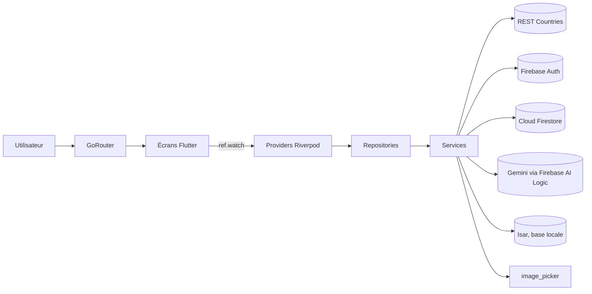

# Documentation technique de WonderLand

WonderLand est une application mobile Flutter de préparation de voyage.
L'utilisateur choisit un pays, Gemini génère un itinéraire de trois jours dans
sa capitale, et l'itinéraire peut être conservé en favori, lisible hors-ligne.
Une photo de monument peut aussi être envoyée à Gemini Vision, qui identifie
le lieu et le pays.

Ce dossier décrit le fonctionnement interne du projet. Le [README](../README.md)
à la racine reste la présentation courte (fonctionnalités, installation
rapide, pitch).

## Sommaire

| Document | Contenu |
|---|---|
| [architecture.md](architecture.md) | Couches de l'application, flux de données, providers Riverpod, navigation GoRouter |
| [data-and-persistence.md](data-and-persistence.md) | Modèles, base locale Isar, Cloud Firestore, stratégie hors-ligne, règles de sécurité |
| [services.md](services.md) | Intégrations externes : REST Countries, Firebase Auth, Gemini (Firebase AI Logic), App Check, image_picker |
| [setup.md](setup.md) | Prérequis, configuration Firebase, variables d'environnement, lancement, dépannage |
| [Image-Design/](Image-Design/) | Maquettes des écrans (signin, parcours, saved) |
| [Video-App/](Video-App/) | Vidéo de démonstration (parcours complet sur iPhone) et les GIF animés du README |

## Fiche d'identité

| | |
|---|---|
| Nom du package Dart | `projet` |
| Nom affiché | WonderLand |
| Flutter / Dart | 3.47.4 / SDK `^3.13.3` |
| Gestion d'état | Riverpod 2.x (`flutter_riverpod ^2.6.1`) |
| Navigation | GoRouter (`go_router ^18.0.1`), routes dans `lib/router/app_router.dart` |
| Base locale | Isar 3 (`isar_community ^3.3.2`) |
| Backend | Firebase (projet `wanderlens-app`) : Auth, Cloud Firestore, AI Logic, App Check |
| IA | Gemini `gemini-3.5-flash-lite`, texte et vision, via `firebase_ai ^4.0.0` |
| API publique | REST Countries v5 |
| Plateformes ciblées | Android, iOS |

## Vue d'ensemble

Chaque écran observe un ou plusieurs providers et affiche leur état
(`loading`, `data`, `error`). Les écrans ne font aucun appel réseau et aucun
calcul métier : c'est le rôle des repositories et des services.

## Conventions du projet

- Une classe par fichier, nommée comme le fichier (`gemini_service.dart`
  contient `GeminiService`).
- Les widgets internes à un écran sont privés (préfixe `_`) et restent dans le
  fichier de l'écran.
- Les commentaires de code sont en français ; les textes affichés à l'écran
  sont en anglais, comme sur les maquettes.
- Aucun `StatefulWidget` dans les écrans qui dépendent de Riverpod ; l'état
  d'interface passe par des `StateProvider`. Seule exception : `LoginPage`,
  qui ne dépend d'aucun provider et gère ses champs de formulaire localement.
- Aucune navigation impérative (`Navigator.push`) dans les écrans : les
  routes sont centralisées dans `lib/router/app_router.dart` et les écrans
  appellent `context.push('/...')`.
- Les erreurs des services sont transformées en exceptions lisibles
  (`CountriesException`, `GeminiException`) dont le `toString()` est affiché
  tel quel à l'écran.
- `flutter analyze` doit rester sans avertissement (`flutter_lints ^6.0.0`).
