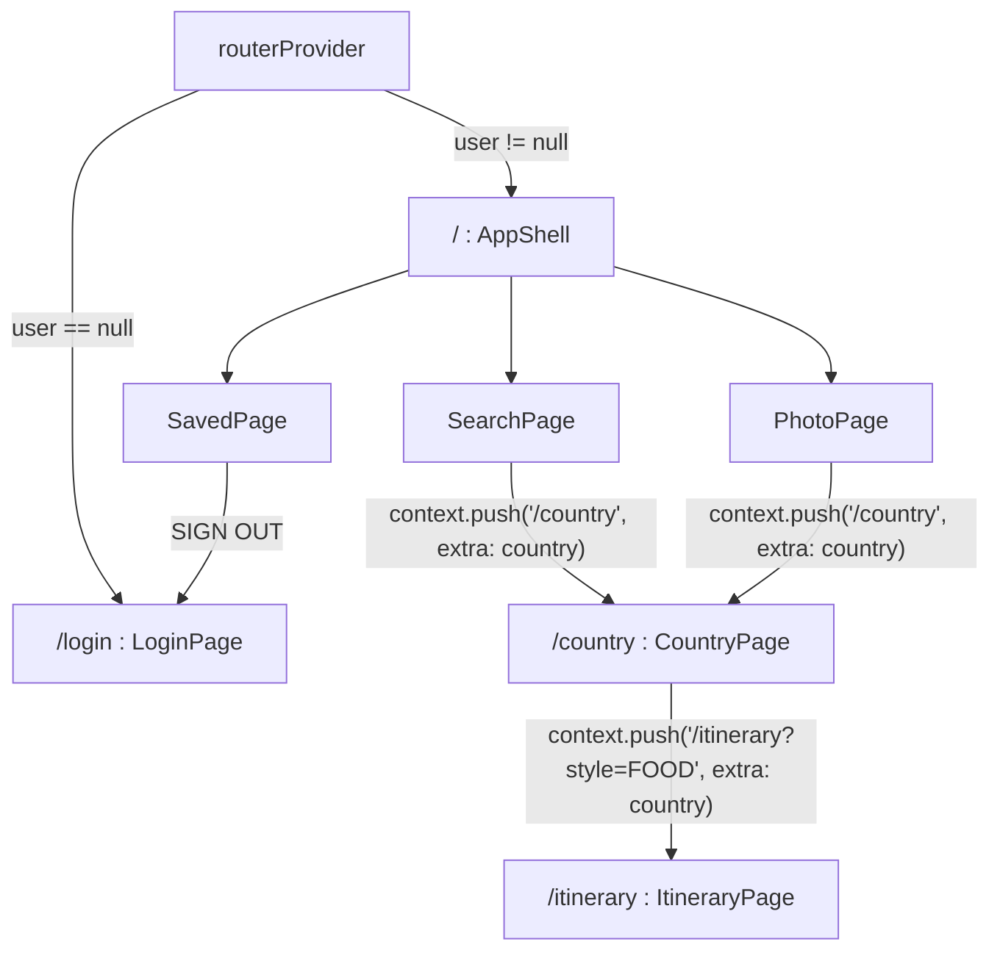

# Architecture

## 1. Organisation en couches

Le code suit la structure vue en cours : `models / services / repositories /
providers / screens`. Les dépendances vont toujours dans un seul sens, du haut
vers le bas.

```
router                (GoRouter : quelle page pour quelle URL)
        |
screens, widgets      (affichage, ConsumerWidget)
        |
providers             (Riverpod : expose l'état aux écrans)
        |
repositories          (logique métier, combine plusieurs services)
        |
services              (un client par technologie externe)
        |
models                (objets de données, sans dépendance Flutter)
```

| Dossier | Rôle | Fichiers |
|---|---|---|
| `lib/models/` | Objets de données purs. `Country` et `PhotoAnalysis` sont immuables ; `Itinerary` est une collection Isar. | `country.dart`, `itinerary.dart`, `itinerary.g.dart` (généré), `photo_analysis.dart` |
| `lib/services/` | Accès aux technologies externes. Aucune logique métier. | `auth_service.dart`, `countries_service.dart`, `firestore_service.dart`, `gemini_service.dart`, `local_db_service.dart`, `photo_service.dart` |
| `lib/repositories/` | Orchestration : décide quel service appeler et dans quel ordre. | `country_repository.dart`, `itinerary_repository.dart`, `photo_repository.dart` |
| `lib/providers/` | Déclarations Riverpod. Les écrans ne connaissent que ces providers. | `auth_providers.dart`, `country_providers.dart`, `itinerary_providers.dart`, `photo_providers.dart`, `ui_providers.dart` |
| `lib/router/` | Toutes les routes GoRouter et la garde d'authentification. | `app_router.dart` |
| `lib/screens/` | Un fichier par écran. | `login_page.dart`, `search_page.dart`, `country_page.dart`, `itinerary_page.dart`, `photo_page.dart`, `saved_page.dart` |
| `lib/widgets/` | Widgets partagés entre plusieurs écrans. | `app_shell.dart`, `day_card.dart`, `message_view.dart` |
| `lib/constants/` | Palette de couleurs. | `app_colors.dart` |

## 2. Démarrage de l'application

`lib/main.dart` exécute trois étapes avant `runApp` :

1. `Firebase.initializeApp` avec `DefaultFirebaseOptions.currentPlatform`
   (fichier `firebase_options.dart` généré par `flutterfire configure`).
2. `FirebaseAppCheck.instance.activate` : fournisseur de débogage en mode
   debug (`kDebugMode`), Play Integrity / DeviceCheck en release. App Check
   est obligatoire pour que Firebase AI Logic accepte les appels Gemini.
3. `LocalDbService.open()` ouvre la base Isar dans le dossier documents de
   l'application.

L'instance Isar est ensuite injectée dans l'arbre de providers :

```dart
runApp(
  ProviderScope(
    overrides: [isarProvider.overrideWithValue(isar)],
    child: const MyApp(),
  ),
);
```

`isarProvider` lève une `UnimplementedError` s'il n'est pas surchargé : cela
rend l'oubli impossible à rater et permet de fournir une autre instance
sans modifier le reste du code.

`MyApp` (`ConsumerWidget`) attend la première valeur de `authStateProvider`
(Firebase restaure la session précédente) en affichant un indicateur, puis
construit un `MaterialApp.router` branché sur `routerProvider`.

## 3. Navigation avec GoRouter

La navigation est déclarative (`go_router ^18.0.1`) : toutes les routes sont
déclarées dans `lib/router/app_router.dart`, et les écrans ne font jamais de
`Navigator.push`.

| URL | Écran | Paramètres |
|---|---|---|
| `/login` | `LoginPage` | |
| `/` | `AppShell` (onglets SEARCH, PHOTO, SAVED) | |
| `/country` | `CountryPage` | `extra` : l'objet `Country` |
| `/itinerary?style=FOOD` | `ItineraryPage` | `extra` : `Country` ; query parameter `style` |



### Le routeur est un provider

```dart
final routerProvider = Provider<GoRouter>((ref) {
  final user = ref.watch(authStateProvider).value;

  final router = GoRouter(
    initialLocation: '/',
    redirect: (context, state) {
      final loggedIn = user != null;
      final onLogin = state.matchedLocation == '/login';
      if (!loggedIn && !onLogin) return '/login';
      if (loggedIn && onLogin) return '/';
      return null;
    },
    routes: [...],
  );
  ref.onDispose(router.dispose);
  return router;
});
```

- **Garde d'authentification.** `redirect` est évalué à chaque navigation.
  Sans utilisateur, toute URL renvoie vers `/login` ; avec un utilisateur,
  `/login` renvoie vers `/`. Il n'y a donc aucune navigation explicite après
  la connexion ou la déconnexion.
- **Rafraîchissement.** Le provider fait `ref.watch(authStateProvider)` :
  quand Firebase émet un nouvel utilisateur (ou `null`), Riverpod reconstruit
  le `GoRouter`, `MaterialApp.router` reçoit la nouvelle configuration et le
  `redirect` s'applique. C'est plus simple qu'un `refreshListenable` et
  suffisant ici, car on veut de toute façon repartir de zéro à la connexion
  et à la déconnexion.
- **`context.push` vs `context.go`.** Les fiches pays et itinéraire sont
  empilées avec `context.push`, ce qui donne le bouton BACK (`context.pop()`)
  et le geste de retour. `go` n'est pas utilisé : le changement d'onglet se
  fait dans `AppShell` avec `currentTabProvider` et un `IndexedStack`, ce qui
  garde les trois écrans montés (la liste des pays n'est pas rechargée).
- **Passage de données.** L'objet `Country` complet est transmis avec `extra`
  (pas besoin de le recharger depuis l'API dans la page cible). Le style de
  voyage, une simple chaîne, passe en query parameter et est lu avec
  `state.uri.queryParameters['style']`.
- `LoginPage` reçoit `authServiceProvider` par son constructeur pour partager
  la même instance d'`AuthService` que le bouton SIGN OUT (l'état
  d'initialisation de Google Sign-In y est stocké).

## 4. Riverpod : inventaire des providers

| Provider | Fichier | Type | Ce qu'il fournit |
|---|---|---|---|
| `authServiceProvider` | auth_providers | `Provider<AuthService>` | Instance unique d'`AuthService` |
| `authStateProvider` | auth_providers | `StreamProvider<User?>` | Utilisateur Firebase courant, `null` si déconnecté |
| `countryRepositoryProvider` | country_providers | `Provider<CountryRepository>` | Repository des pays (construit un `CountriesService`) |
| `countriesProvider` | country_providers | `FutureProvider<List<Country>>` | Liste complète des pays, chargée une fois |
| `searchQueryProvider` | country_providers | `StateProvider<String>` | Texte de la barre de recherche |
| `isarProvider` | itinerary_providers | `Provider<Isar>` | Instance Isar, surchargée dans `main` |
| `geminiServiceProvider` | itinerary_providers | `Provider<GeminiService>` | Client Gemini partagé (itinéraires et photos) |
| `itineraryRepositoryProvider` | itinerary_providers | `Provider<ItineraryRepository>` | Repository des itinéraires (Gemini + Isar + Firestore) |
| `itineraryProvider` | itinerary_providers | `FutureProvider.autoDispose.family<Itinerary, ItineraryRequest>` | Un itinéraire généré par requête (pays, capitale, style) |
| `savedItinerariesProvider` | itinerary_providers | `StreamProvider<List<Itinerary>>` | Favoris de l'utilisateur courant, lus dans Isar |
| `photoRepositoryProvider` | photo_providers | `Provider<PhotoRepository>` | Repository photo (image_picker + Gemini Vision) |
| `photoProvider` | photo_providers | `AsyncNotifierProvider.autoDispose<PhotoNotifier, PhotoResult?>` | Résultat de la dernière analyse photo |
| `currentTabProvider` | ui_providers | `StateProvider<int>` | Onglet actif (0 SEARCH, 1 PHOTO, 2 SAVED) |
| `travelStyleProvider` | ui_providers | `StateProvider<String>` | Style de voyage sélectionné sur la fiche pays |
| `itinerarySavedProvider` | ui_providers | `StateProvider.autoDispose<bool>` | `true` une fois l'itinéraire affiché sauvegardé |

### Choix des types de providers

- `Provider` pour les objets sans état observable (services, repositories).
  Ils sont créés une seule fois et partagés.
- `FutureProvider` quand la donnée est chargée une fois à l'ouverture de
  l'écran (liste des pays, itinéraire). Le provider expose un `AsyncValue`
  que l'écran affiche avec `.when(loading:, error:, data:)`.
- `StreamProvider` quand la donnée change dans le temps sans action de
  l'utilisateur (session Firebase, favoris Isar).
- `StateProvider` pour un état d'interface simple (texte tapé, onglet actif,
  puce sélectionnée). Il remplace `setState` et supprime les
  `StatefulWidget`.
- `AsyncNotifier` pour `photoProvider`, parce que le travail est déclenché par
  un bouton (CAMERA ou GALLERY) et non par l'ouverture de l'écran. La méthode
  `analyze` passe l'état à `AsyncLoading`, puis `AsyncData` ou `AsyncError`.

### `family` et `autoDispose`

`itineraryProvider` est paramétré par un record Dart :

```dart
typedef ItineraryRequest = ({String countryName, String capital, String travelStyle});
```

Deux records avec les mêmes valeurs sont égaux, donc Riverpod met en cache un
résultat par combinaison (pays, capitale, style). Avec `autoDispose`, ce cache
est libéré quand on quitte l'écran : revenir sur le même pays relance une
génération. Le bouton RETRY appelle `ref.invalidate(itineraryProvider(request))`
pour forcer un nouvel appel sans quitter l'écran.

## 5. Flux de données par écran

### SearchPage

```dart
final countries = ref.watch(countriesProvider);
final query = ref.watch(searchQueryProvider);
final repository = ref.watch(countryRepositoryProvider);

return countries.when(
  loading: () => const CircularProgressIndicator(),
  error: (error, _) => MessageView(title: 'Could not load countries.', message: '$error', buttonLabel: 'RETRY', onPressed: () => ref.invalidate(countriesProvider)),
  data: (all) => _CountryList(countries: repository.filter(all, query)),
);
```

Le `TextField` écrit dans `searchQueryProvider` ; chaque frappe reconstruit
l'écran avec la liste filtrée par `CountryRepository.filter`. La liste
complète n'est pas retéléchargée.

### CountryPage

Écran sans provider de données : il reçoit le `Country` en paramètre du
constructeur. Seule la puce de style est observée (`travelStyleProvider`).
Le bouton fait `context.push('/itinerary?style=$selected', extra: country)`.

### ItineraryPage

1. `ref.watch(itineraryProvider(_request))` déclenche la génération Gemini au
   premier affichage.
2. `loading` affiche la bulle de requête et un indicateur ; `error` affiche le
   message Gemini avec RETRY ; `data` affiche le résumé et trois `DayCard`.
3. SAVE TO FAVORITES appelle `ItineraryRepository.save(itinerary, uid)`, puis
   passe `itinerarySavedProvider` à `true` (le bouton devient SAVED et se
   désactive) et affiche un `SnackBar`. Le `context.mounted` est vérifié
   après le `await`, comme demandé par le cours.

### PhotoPage

Les boutons CAMERA et GALLERY appellent
`ref.read(photoProvider.notifier).analyze(source)`. Pendant le traitement,
`photo.isLoading` désactive les deux boutons. Le résultat (`PhotoResult`)
contient les octets de l'image, pour l'afficher, et l'analyse Gemini.
`_ResultView` cherche ensuite le pays deviné dans la liste déjà chargée par
`countriesProvider` (`CountryRepository.findByName`) et propose un bouton
OPEN (`context.push('/country', extra: country)`) si le pays est trouvé.

### SavedPage

`savedItinerariesProvider` lit Isar en continu (`watch(fireImmediately: true)`),
donc l'écran se met à jour tout seul après une sauvegarde ou une suppression,
y compris sans réseau. REMOVE appelle `ItineraryRepository.delete`. Le bandeau
de compte affiche l'email ou `Guest · anon xxxx...` et un bouton SIGN OUT.

## 6. Gestion des erreurs

| Situation | Comportement |
|---|---|
| Clé REST Countries absente | `CountriesException` explicite dès le premier appel, affichée dans SearchPage |
| Pas de réseau sur Search | `CountriesException("Pas de connexion réseau")` + bouton RETRY |
| Gemini indisponible, App Check refusé, modèle saturé | `GeminiException` affichée dans ItineraryPage ou PhotoPage, RETRY sur l'itinéraire |
| Réponse Gemini vide | `GeminiException("Gemini a renvoyé une réponse vide.")` |
| Écriture Firestore refusée ou hors-ligne | Ignorée dans `FirestoreService` : le favori est déjà dans Isar |
| Lecture Firestore impossible au démarrage | `syncFromCloud` avale l'erreur, la liste locale suffit |
| Sélecteur d'image fermé sans choix | `pickAndAnalyze` renvoie `null`, `PhotoNotifier` conserve le résultat précédent |
| Annulation Google ou Apple | `signInWithGoogle` / `signInWithApple` renvoient `null`, aucun message |
| Erreur Firebase Auth | `AuthService.describeError` traduit le code en message français |
