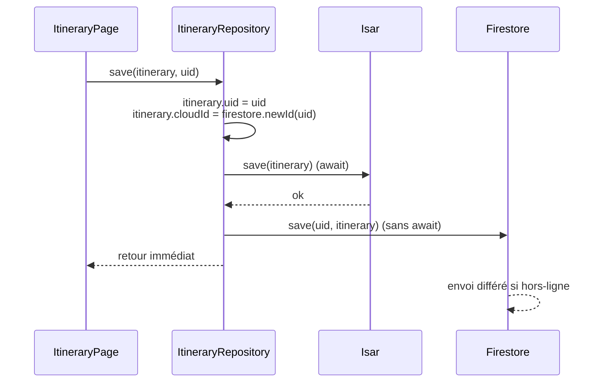

# Données et persistance

## 1. Modèles

### `Country` (`lib/models/country.dart`)

Objet immuable construit à partir de la réponse REST Countries v5.

| Champ | Type | Origine JSON | Exemple |
|---|---|---|---|
| `code` | `String` | `codes.alpha_2` | `PT` |
| `name` | `String` | `names.common` | `Portugal` |
| `capital` | `String` | `capitals[0].name` | `Lisbon` |
| `region` | `String` | `region` | `Europe` |
| `subregion` | `String` | `subregion` | `Southern Europe` |
| `population` | `int` | `population` | `10305564` |
| `languages` | `List<String>` | `languages[].name` | `[Portuguese]` |
| `currency` | `String` | `currencies[0]` formaté `name (symbol)` | `Euro (€)` |
| `callingCode` | `String` | `+` + `calling_codes[0]` | `+351` |
| `flagUrl` | `String` | `flag.url_png` | URL PNG |

Méthodes utiles :

- `Country.fromJson(map)` : tolérant, chaque champ manquant devient une
  chaîne vide, `0` ou une liste vide. L'application ne plante pas si l'API
  renvoie un pays incomplet.
- `matches(query)` : `true` si la requête, sans tenir compte de la casse,
  apparaît dans le nom ou la capitale. Une requête vide accepte tout.
- `subtitle` : `capitale · sous-région`, en ignorant les valeurs vides.
- `populationText` : `10305564` devient `10,305,564`.

### `Itinerary` et `ItineraryDay` (`lib/models/itinerary.dart`)

`Itinerary` est la seule collection Isar du projet (`@collection`).
`ItineraryDay` est `@embedded` : il est stocké à l'intérieur de l'itinéraire
et n'a pas de table propre.

| Champ | Type | Rôle |
|---|---|---|
| `id` | `Id` | Clé primaire Isar, `Isar.autoIncrement` |
| `cloudId` | `String` | Identifiant du document Firestore, nécessaire pour la suppression |
| `uid` | `String` | Propriétaire (uid Firebase), sert de filtre dans Isar |
| `countryName` | `String` | Pays choisi (`Portugal`) |
| `city` | `String` | Ville renvoyée par Gemini (`Lisbon`) |
| `travelStyle` | `String` | `FOOD`, `CULTURE`, `NATURE`, `HISTORY` ou `NIGHTLIFE` |
| `summary` | `String` | Phrase d'introduction de Gemini |
| `days` | `List<ItineraryDay>` | Trois journées (`title`, `description`) |
| `createdAt` | `DateTime` | Date de génération, tri décroissant |

`toMap()` / `fromMap()` servent à la fois pour Firestore et pour lire la
réponse JSON de Gemini (qui ne contient que `city`, `summary`, `days` ;
`countryName` et `travelStyle` sont ajoutés par `GeminiService`).

Le fichier `itinerary.g.dart` est généré par `isar_community_generator` et
contient le schéma (`ItinerarySchema`), les accesseurs (`isar.itinerarys`) et
les filtres typés (`uidEqualTo`, `sortByCreatedAtDesc`). Il est versionné
pour que le projet compile sans lancer `build_runner`, mais il doit être
régénéré après toute modification du modèle :

```sh
dart run build_runner build --delete-conflicting-outputs
```

### `PhotoAnalysis` (`lib/models/photo_analysis.dart`)

Réponse de Gemini Vision : `placeName`, `countryName`, `description`. Les
deux premiers peuvent être vides si Gemini n'est pas sûr ; l'écran affiche
alors `Unknown place` et `COUNTRY UNKNOWN`.

## 2. Base locale Isar (`lib/services/local_db_service.dart`)

| Méthode | Description |
|---|---|
| `LocalDbService.open()` | Ouvre la base une fois, dans `getApplicationDocumentsDirectory()` |
| `watchAll(uid)` | `Stream<List<Itinerary>>` filtré par `uid`, trié par `createdAt` décroissant, `fireImmediately: true` |
| `getAll(uid)` | Même requête, en lecture ponctuelle (utilisée par la synchronisation) |
| `save(itinerary)` | `put` dans une `writeTxn` |
| `saveAll(list)` | `putAll` dans une `writeTxn` |
| `delete(id)` | Suppression par clé Isar |

Toute écriture passe par `writeTxn` : c'est une exigence d'Isar.

Le package utilisé est `isar_community`, fork maintenu d'Isar 3 avec la même
API, parce que le package `isar` officiel ne compile plus sur les versions
récentes d'Android.

## 3. Cloud Firestore (`lib/services/firestore_service.dart`)

Structure des documents :

```
users/{uid}/itineraries/{cloudId}
    countryName, city, travelStyle, summary,
    days: [{title, description}, ...],
    createdAt: ISO 8601
```

| Méthode | Description |
|---|---|
| `newId(uid)` | Génère un identifiant de document côté client, sans réseau |
| `getAll(uid)` | Tous les favoris du cloud, du plus récent au plus ancien |
| `save(uid, itinerary)` | `set` du document ; toute erreur est ignorée |
| `delete(uid, cloudId)` | Suppression ; toute erreur est ignorée |

Les erreurs sont volontairement avalées dans `save` et `delete` : le favori
est déjà en local, le cloud ne doit jamais faire planter l'application.

### Règles de sécurité (`firestore.rules`)

```
match /users/{uid}/{document=**} {
  allow read, write: if request.auth != null && request.auth.uid == uid;
}
```

Un utilisateur, connecté par email ou en invité anonyme, ne peut lire et
écrire que sa propre sous-collection. Les règles sont déployées avec
`firebase deploy --only firestore:rules` (référencées dans `firebase.json`).

## 4. Stratégie de double sauvegarde



Principes :

1. **Isar d'abord.** `await localDb.save(...)` : la sauvegarde locale est
   confirmée avant de rendre la main.
2. **Firestore ensuite, sans attendre.** L'appel `firestore.save(...)` n'est
   pas `await`. Hors-ligne, le SDK Firestore met l'écriture en file et
   l'envoie au retour du réseau. L'utilisateur voit le bouton passer à SAVED
   immédiatement, connecté ou non.
3. **Lecture uniquement locale.** `savedItinerariesProvider` observe Isar,
   jamais Firestore. L'onglet SAVED fonctionne donc en mode avion.
4. **Rapatriement au démarrage.** `syncFromCloud(uid)` est appelé une fois
   quand `savedItinerariesProvider` se construit : il lit Firestore, compare
   les `cloudId` avec ceux présents dans Isar, et insère ceux qui manquent
   (nouvel appareil, réinstallation). En cas d'erreur réseau, il ne fait
   rien.
5. **Suppression symétrique.** `delete` supprime dans Isar (attendu) puis
   dans Firestore (non attendu).

Chaque `Itinerary` connaît son `cloudId` dès la sauvegarde, ce qui rend la
suppression et la comparaison possibles sans requête supplémentaire.

## 5. Comportement hors-ligne, écran par écran

| Écran | Sans réseau |
|---|---|
| Sign in | Firebase restaure la session précédente ; une nouvelle connexion échoue avec `Pas de connexion réseau.` |
| Search | `Could not load countries.` + RETRY (pas de cache de la liste des pays) |
| Country | Fonctionne (données déjà en mémoire) ; le drapeau ne se charge pas, le fond sombre reste |
| Itinerary | `Gemini could not answer.` + RETRY |
| Photo | Sélection possible, analyse en erreur avec message Gemini |
| Saved | Favoris affichés normalement depuis Isar ; SAVE et REMOVE fonctionnent et se synchronisent plus tard |
